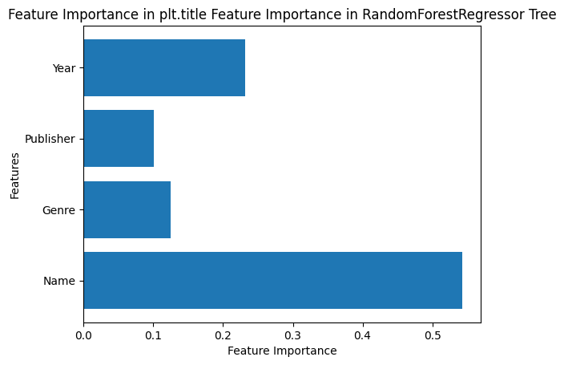
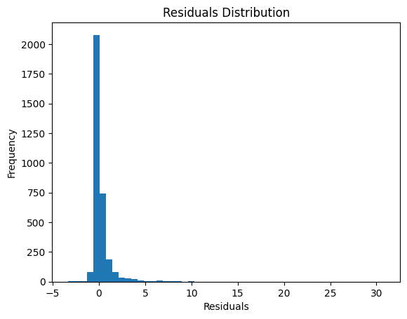

# Video Game Sales Prediction


A machine learning model that **predicts global video game sales** from a game's
name, genre, publisher, and release year.

This was my semester project for Intro to AI at The Village School, rebuilt here as a standalone
repo (originally `semester-project.ipynb` inside a coursework repo).

## Approach
- **Problem type:** Regression — predicting a continuous target (`Global_Sales`, in millions of units)
- **Dataset:** [Video Game Sales](https://www.kaggle.com/datasets/gregorut/videogamesales) (`vgsales.csv`, 16,598 games)
- **Features:** Name, Genre, Publisher, Year
- **Preprocessing:** Missing-value imputation, then one-hot encoding for the categorical features
- **Models compared:** Decision Tree vs. Random Forest (`RandomForestRegressor`, scikit-learn)
- **Split:** 80% train / 20% validation, `random_state=1`
- **Evaluation:** Mean Absolute Error (MAE), residual analysis, feature importance

## Results
Training MAE for the tuned models in the notebook:

| Model | Training MAE |
|---|---|
| Random Forest | 0.21 |
| Decision Tree | 0.34 |

Reproduced end-to-end outside Kaggle with `reproduce.py` (same split, preprocessing, and final
Random Forest settings — 50 trees, max depth 100):

- **Validation MAE: 0.451** (millions of units)
- **Validation R²: 0.005**

In plain terms: the features in this dataset barely predict sales on games the model has not
seen. A few hit titles sell tens of millions while most games sell almost nothing, and
name/genre/publisher/year does not separate them — the residuals below show the model
under-predicting every big seller. The value of the project is the pipeline and the analysis,
not the accuracy.





## Run it
The notebook (`video-game-sales-prediction.ipynb`) was written for Kaggle and loads the
dataset from Kaggle paths.

To reproduce the results anywhere:

```bash
pip install pandas scikit-learn numpy
python reproduce.py
```

`reproduce.py` downloads the dataset from Kaggle's public endpoint (no account needed),
trains the final model, and prints the metrics above. GitHub Actions runs it on every push.

## Tech
Python · pandas · NumPy · Matplotlib · scikit-learn · Jupyter
